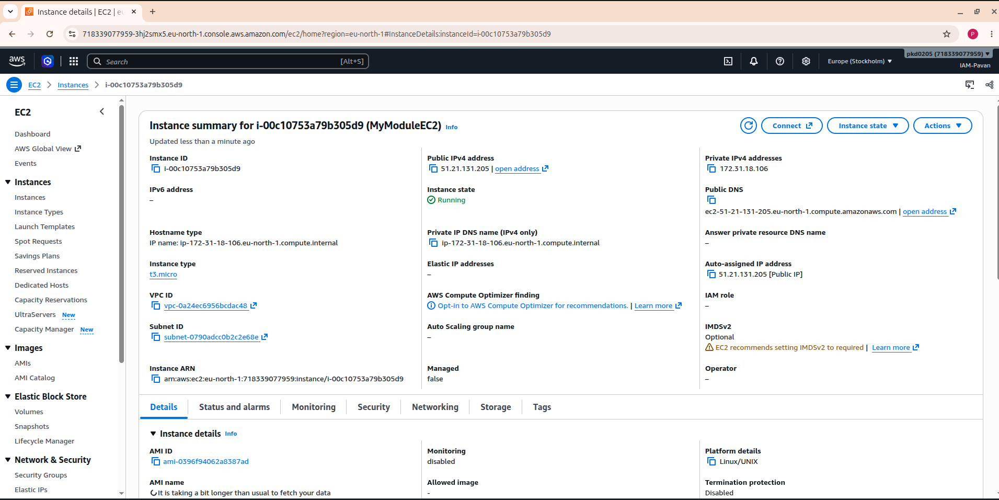

# AWS EC2 Instance Provisioning Using Terraform Modules

A hands-on Infrastructure as Code (IaC) project demonstrating how to provision AWS EC2 instances using reusable Terraform Modules.

This project follows a modular architecture to organize Terraform configurations, improve code reusability, and simplify infrastructure management.

---

## 📌 Project Overview

The main objective of this project is to provision an AWS EC2 instance using Terraform Modules.

Instead of writing the entire infrastructure configuration in a single file, the project separates the root configuration from the reusable child module.

This approach makes the infrastructure code cleaner, more organized, reusable, and easier to maintain.

### 🎯 Project Objectives

- Provision AWS EC2 instances using Terraform.
- Understand Terraform Modules and their architecture.
- Implement Root Module and Child Module concepts.
- Manage infrastructure using input variables.
- Retrieve resource information using Terraform outputs.
- Follow a modular Infrastructure as Code approach.
- Improve code reusability and maintainability.

## 🏗️ Project Architecture

The project uses a Root Module to call a reusable Child Module, which contains the EC2 resource configuration.

```text
                  Terraform CLI
                       |
                       v
                 Root Module
                       |
             +---------+---------+
             |         |         |
             v         v         v
           main.tf  variable.tf outputs.tf
                       |
                       v
                  Module Call
                       |
                       v
                  Child Module
                       |
             +---------+---------+
             |         |         |
             v         v         v
           main.tf  variable.tf outputs.tf
                       |
                       v
                   AWS EC2
                    Instance
                       |
                       v
                Terraform Outputs
```

### How It Works

1. Terraform starts execution from the Root Module.
2. The Root Module calls the Child Module.
3. Input variables are passed to the Child Module.
4. The Child Module uses the provided values to define the EC2 instance.
5. Terraform provisions the EC2 instance in AWS.
6. Outputs can return useful instance information to the Root Module.

## 🧠 What Is a Terraform Module?

A Terraform Module is a collection of Terraform configuration files that work together to manage infrastructure.

In simple words, a module is a reusable infrastructure template.

**Example:**

Imagine creating multiple EC2 instances with similar configurations.

Without modules, you may need to write similar resource configurations repeatedly.

With Terraform Modules, you write the infrastructure configuration once and reuse it whenever required.

### Why Use Terraform Modules?

- **Reusability:** Reuse the same infrastructure configuration.
- **Maintainability:** Manage infrastructure through organized files.
- **Scalability:** Extend configurations as infrastructure grows.
- **Readability:** Keep Terraform code clean and understandable.
- **Consistency:** Use a common infrastructure structure across environments.

## 🔍 Types of Modules Used in This Project

### 1. Root Module

The Root Module is the main Terraform configuration directory from which Terraform execution begins.

It contains the configuration files that call and manage the Child Module.

**Files:**

- `main.tf` – Calls the Child Module.
- `variable.tf` – Defines input variables.
- `outputs.tf` – Defines infrastructure output values.

### 2. Child Module

The Child Module is a reusable collection of Terraform configuration files.

In this project, the Child Module is stored inside the `Module/` directory and contains the EC2 resource configuration.

**Files:**

- `main.tf` – Defines the AWS EC2 resource.
- `variable.tf` – Declares variables required by the module.
- `outputs.tf` – Exposes useful information about the created resource.

### Root Module vs Child Module

| Root Module | Child Module |
|---|---|
| Main project configuration | Reusable infrastructure configuration |
| Calls the Child Module | Defines the EC2 resource |
| Passes input variables | Receives input variables |
| Can expose final outputs | Returns resource outputs |
| Located in the project root | Located inside `Module/` |

## 📂 Project Structure

```text
.
├── main.tf
├── Module
│   ├── main.tf
│   ├── outputs.tf
│   └── variable.tf
├── Output.png
├── outputs.tf
├── README.md
├── terraform.tfstate
└── variable.tf
```

### File and Directory Explanation

| File / Directory | Description |
|---|---|
| `main.tf` | Root configuration that calls the Child Module. |
| `variable.tf` | Declares input variables for the Root Module. |
| `outputs.tf` | Defines output values at the Root Module level. |
| `Module/` | Contains the reusable Child Module. |
| `Module/main.tf` | Defines the AWS EC2 instance resource. |
| `Module/variable.tf` | Declares input variables required by the Child Module. |
| `Module/outputs.tf` | Defines outputs returned by the Child Module. |
| `Output.png` | Screenshot showing the project execution output. |
| `README.md` | Project documentation. |
| `terraform.tfstate` | Local Terraform state file tracking managed resources. |

**Note:** The state file is shown in the original project structure for reference. It should not be committed to a public GitHub repository.

## 🛠️ Technologies Used

| Technology | Purpose |
|---|---|
| Terraform | Infrastructure as Code |
| AWS | Cloud infrastructure provider |
| Amazon EC2 | Virtual server provisioning |
| Terraform Modules | Reusable infrastructure configuration |
| Linux | Command-line environment |
| Git & GitHub | Version control and project hosting |

## 📋 Prerequisites

Before running this project, make sure you have:

- An AWS account.
- Terraform installed.
- AWS CLI installed.
- AWS credentials configured securely.
- Appropriate IAM permissions to manage EC2 resources.

Verify the installations:

```bash
terraform -version
aws --version
aws sts get-caller-identity
```

The last command verifies your currently configured AWS identity.

## 🚀 Getting Started

### Step 1: Clone the Repository

```bash
git clone <YOUR-REPOSITORY-URL>
cd <YOUR-PROJECT-DIRECTORY>
```

Replace the placeholders with your actual GitHub repository URL and project directory.

### Step 2: Initialize Terraform

```bash
terraform init
```

This command initializes the Terraform working directory and downloads the required providers.

### Step 3: Format Terraform Files

```bash
terraform fmt -recursive
```

This formats Terraform configuration files, including those inside the `Module/` directory.

### Step 4: Validate the Configuration

```bash
terraform validate
```

This checks whether the Terraform configuration is syntactically valid and internally consistent.

### Step 5: Review the Execution Plan

```bash
terraform plan
```

Terraform generates an execution plan showing the infrastructure changes it intends to make.

Review the plan before applying it.

### Step 6: Create the EC2 Instance

```bash
terraform apply
```

Review the proposed changes and enter `yes` when prompted to confirm the deployment.

Terraform will execute the configuration and provision the resources defined in your project.

### Step 7: View Terraform Outputs

```bash
terraform output
```

This displays the output values defined in the Root Module.

## 🔄 Terraform Module Workflow

The following workflow explains how the Root Module communicates with the Child Module.

**1. Root Module calls Child Module**

The Root Module references the local module directory using a module source path.

Example:

```hcl
module "ec2" {
  source = "./Module"
}
```

**2. Child Module receives variables**

Input values are declared in the Child Module's `variable.tf` file.

**3. EC2 resource is created**

The Child Module's `main.tf` defines the AWS EC2 resource using the provided configuration.

**4. Outputs are returned**

The Child Module's `outputs.tf` can expose useful resource information, which the Root Module can reference.

For example:

```hcl
output "instance_id" {
  value = module.ec2.instance_id
}
```

The output name must match the output actually declared inside the Child Module.

## 📸 Project Output

The following screenshot represents the output captured during the EC2 provisioning process.



## 🔍 Useful Terraform Commands

| Command | Purpose |
|---|---|
| `terraform init` | Initializes the Terraform project. |
| `terraform fmt -recursive` | Formats all Terraform configuration files. |
| `terraform validate` | Validates the configuration. |
| `terraform plan` | Previews infrastructure changes. |
| `terraform apply` | Creates or updates infrastructure. |
| `terraform output` | Displays configured outputs. |
| `terraform state list` | Lists resources tracked in the state. |
| `terraform show` | Displays the current state or plan details. |
| `terraform destroy` | Destroys resources managed by the configuration. |

## 🧹 Cleanup

When you no longer need the EC2 infrastructure, you can remove the resources managed by Terraform.

First, review the destruction plan:

```bash
terraform plan -destroy
```

Then execute:

```bash
terraform destroy
```

Review the resources carefully and confirm the operation when prompted.

**Warning:** Destroying infrastructure permanently removes the managed resources. Make sure you no longer need the EC2 instance or its associated data before proceeding.

## 🔐 Security Best Practices

- Never hardcode AWS access keys in Terraform files.
- Use IAM roles or securely configured AWS credentials.
- Never upload Terraform state files to public repositories.
- Use `.gitignore` to exclude state files and sensitive variables.
- Follow the principle of least privilege for IAM permissions.
- Review Security Group rules before deploying EC2 instances.
- Avoid exposing unnecessary ports to the public internet.
- Always review `terraform plan` before applying infrastructure changes.

## 🎓 Learning Outcomes

By completing this project, I gained practical experience with:

- AWS EC2 provisioning using Terraform.
- Infrastructure as Code (IaC).
- Terraform Module architecture.
- Root Module and Child Module concepts.
- Input variables and output values.
- Reusable infrastructure configuration.
- Terraform initialization, validation, planning, and deployment.
- Infrastructure lifecycle management.

## 👨‍💻 Author

**Pavan Kumar Dixit**

RHCSA & RHCE Certified | BCA Graduate | Cloud & DevOps Enthusiast

**Technical Interests:**

AWS | Terraform | Linux | Docker | Kubernetes | Jenkins | CI/CD | Prometheus | Grafana

---

⭐ If you find this project useful, consider giving the repository a star on GitHub.